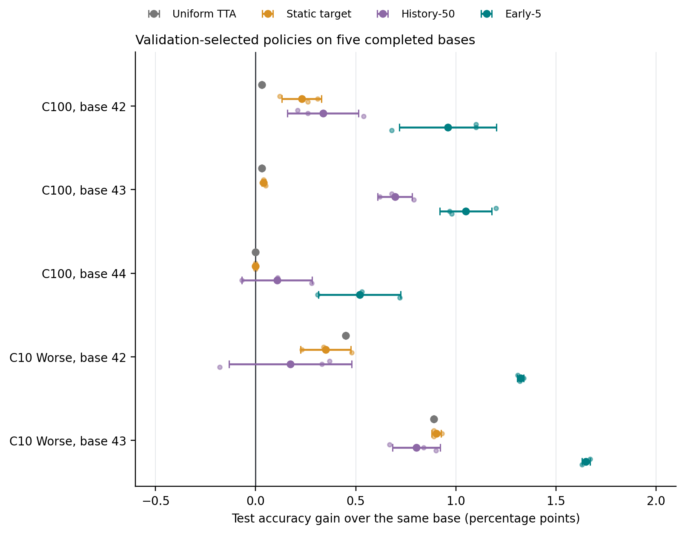
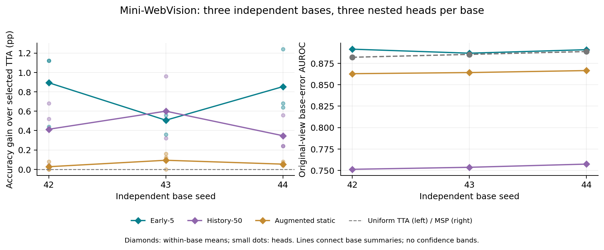

# Room for Doubt

Distilling training dynamics for inference-time uncertainty estimation.

The project studies whether a classifier's training dynamics can be distilled
into a reliability signal for new images. The current estimator predicts an
**early probability-margin summary** from an image and candidate class, then
uses that score to rank base-model errors and weight test-time augmentations.

An [audited redesign pilot](docs/temporal_redesign.md) now implements class-complete
early-snapshot compression with a residual posterior head and an exact identity
fallback. It can change a single-view prediction, unlike scalar view weighting.
This is a separate experimental branch; gains now replicate across three bases,
while temporal-specific attribution and paper-level novelty remain unestablished. The evidence below its summary
still refers to the scalar method.

Frozen clean-test results now cover three independent CIFAR-100N base seeds
(42/43/44), with fixed data split and head seed42. Accuracy gains are **+2.04,
+1.47 and +2.51 pp**: mean **+2.01 pp**, sample SD0.52 pp. Mean accuracy is
69.60% for the base,71.61% for the student and73.26% for the five-snapshot mean.
The stronger teacher remains ahead of every student; ECE worsens on every seed.
A fixed epoch1 distillation control also improves the base. Temporal students
exceed it by0.32pp on seed43 (nominal paired interval includes zero) and0.93pp
on seed44. This supports replicated compression gains, not attribution of the
entire gain to temporal history. At this earlier stage the non-temporal control was pending; the S2 results below
now compare equal teacher pass counts, with unequal training cost. Raw replay passes155 checks for the two follow-ups; evidence
and plots are in `outputs/temporal_replications_import_20261027/`.
The completed S2 controls now cover all three bases: mean accuracy is71.24% for
validation-selected single-snapshot distillation,71.55% for Early-2,71.53% for a
standard direct soft-target head, and71.87% for independent-two-teacher
compression. Early-5 reaches71.61%: only0.077pp above the direct head and0.063pp
above Early-2, with mixed seed-wise differences. Independent teachers require
additional base training and share donors across recipients; equal teacher pass
counts do not mean equal training cost. No distinctive residual or temporal
advantage is established.503 deterministic checks replay the supplied raw
predictions in `outputs/posthoc_controls_import_20261028_verified/`; this does
not regenerate fitting without the omitted weights/train-validation arrays.
The seed42 full epoch-selection grid was recovered from original Kaggle Output
and its20-row ranking exactly matches the frozen policy.
A later frozen-model benchmark on one Tesla T4 measured 6.94 ms for the base, 7.09 ms for Early-5 residual, and 28.79 ms for its five-snapshot teacher at batch size one, including transforms of decoded inputs and GPU transfer. These are means of per-base medians from one hardware session. See Kaggle version 363133601 and the local import `outputs/posthoc_runtime_import_20261110/`. The accuracy comparisons remain exploratory on a known test.
The manuscript records these separately from scalar-method results below.

## Independent CIFAR-10.1 evaluation

The prespecified evaluation on 2,000 CIFAR-10.1 v6 images used three frozen
CIFAR-10N Worse bases. Early-5 residual reached 81.75% versus 81.82% for
the base (mean difference −0.07 percentage points, conditional paired 95%
interval [−0.53, +0.42]). It met the latency criterion (7.26 ms versus
7.21 ms for the base and 31.64 ms for the five-snapshot teacher at batch
size one on T4). The primary accuracy criterion was not met. Direct
distillation reached 82.38% in a secondary comparison. The earlier
CIFAR-100N posterior result remains exploratory.

## CIFAR-10.2 teacher comparison

Across three frozen bases, Early-5 direct scored 77.78% and Static-5 direct
77.80%. The primary difference was −0.02 percentage points (conditional
paired 95% interval [−0.53, +0.48]), below the prespecified 0.50-point
threshold. The five-checkpoint teacher scored 79.37% versus 77.27% for the
five-view static teacher in a secondary comparison. [Replay evidence](paper/evidence/teacher_cifar102/README.md)

## Current evidence

The current exploratory study uses ImageNet-initialized ResNet50 bases trained
for 50 epochs on official CIFAR-N noisy labels. Checkpoints are selected by
minimum noisy-validation cross entropy. A class-conditioned scalar head predicts
the mean margin over the first five epochs (**Early-5**) from frozen base features.

| Dataset / base initialization | Base accuracy | Uniform TTA | Early-5 | Gain over base |
|---|---:|---:|---:|---:|
| CIFAR-100N / 42 | 70.12% | 70.15% | 71.08% | +0.96 pp |
| CIFAR-100N / 43 | 69.23% | 69.26% | 70.28% | +1.05 pp |
| CIFAR-100N / 44 | 69.57% | 69.57% | 70.09% | +0.52 pp |
| CIFAR-10N Worse / 42 | 88.84% | 89.29% | 90.16% | +1.32 pp |
| CIFAR-10N Worse / 43 | 89.63% | 90.52% | 91.28% | +1.65 pp |
| CIFAR-10N Worse / 44 | 88.49% | 88.82% | 90.39% | +1.90 pp |

Early-5 values average three head initializations **within each base**. Those
heads are not three independent base-training runs. Each method selects its own
view count and temperature using noisy validation. Test results have been
inspected during development and remain exploratory. Uniform TTA selects ten views on five bases and one on CIFAR-100N seed44;
Early-5 selects five or ten depending on the base and head. Accuracy is downstream
FP32 evaluation throughout. Across independent bases, mean gains over base are
+0.84 pp (CIFAR-100N, n=3) and +1.62 pp (CIFAR-10N Worse, n=3). Between-base
sample SDs of these gains are 0.28 and 0.29 pp, not confidence intervals.



Large dots show head means; small dots show individual heads; error bars are
sample standard deviations across heads, not confidence intervals across bases.
The uniform-TTA point has no learned head.

Early-5 improves original-view base-error AUROC, but worsens ECE and NLL on
all three CIFAR-100N bases; CIFAR-10N ECE changes direction across bases.
One new CIFAR-100N head has a paired gain interval including zero against base. A two-base CIFAR-100N ensemble reaches **73.01%**, above the weighted
single-base results. No superiority over ensembles or lower inference latency is
claimed. Static and temporal target construction also differs in augmentation
and measurement conditions; the target comparison does not isolate a causal
benefit from time alone.

An augmentation-matched static control now covers all six bases. CIFAR-100N
augmented-static accuracies are **70.32% / 69.27% / 69.57%**, versus Early-5
**71.08% / 70.28% / 70.09%** (bases42/43/44). The mean advantage is **+0.76 pp**;
seven of nine conditional head-level accuracy intervals are positive, while two
on base44 include zero. For CIFAR-10N Worse, the control obtains
**89.28% / 90.61% / 88.91%**, versus **90.16% / 91.28% / 90.39%**;
the mean advantage is **+1.01 pp**, with all nine intervals positive.
All eighteen original-view AUROC difference intervals are positive. These heads
span six independent bases, not eighteen. The control addresses augmentation
acquisition, but does not isolate time from online weights or the CE/GCE schedule.
C10 base42 reuses its verified original checkpoint; rebuilding the feature study
reproduces all 23 previous accuracies, view counts and temperatures and does not
add an independent base. C100 base42 uses a recovered native FP32 probability
cache with recorded provenance and reproduced frozen accuracies; bit-identical
shared probabilities are not claimed.

A preliminary one-session Tesla T4 microbenchmark finds close equal-view timing:
including preprocessing, C100 five-view uniform/Early-5 medians are **20.25/20.36 ms**;
C10 ten-view medians are **40.93/41.01 ms**, batch size one. One-view base medians
are **7.59/7.52 ms**. Four fixed validation images, one session and no independent
timing intervals limit interpretation of small differences. No ensemble is timed.

[Editable manuscript, compact evidence and figure generation](paper/README.md).
All displayed figures and tables can be regenerated without training or weights.

## Animal-10N transfer (three bases completed)

The [frozen protocol](docs/animal10n_protocol.md) transfers the same recipe to
Animal-10N on three independent bases42/43/44. Settings, splits, head seeds and
validation-selection grids were fixed before the pilot; the replications retain
them. Each method averages its three heads within a base before bases are
averaged equally. These are three independent bases, not nine.

| Base seed | FP32 base | Selected uniform TTA | Early-5 | History-50 | Early-5 gain over TTA |
|---|---:|---:|---:|---:|---:|
| 42 | 89.24% | 89.56% | 90.11% | 89.95% | +0.55 pp |
| 43 | 88.80% | 89.86% | 90.01% | 90.22% | +0.15 pp |
| 44 | 89.18% | 89.92% | 89.96% | 89.91% | +0.04 pp |

Mean Early-5 gain is+0.96pp over base and+0.25pp over TTA. The latter has a
between-base sample SD of0.27pp, not a confidence interval. The augmentation
control averages89.83%, versus Early-5 90.03%; only two of nine conditional
accuracy intervals strictly exclude zero, one touches zero and six cross zero.
History-50 and Early-5 have virtually identical mean accuracy (90.0267/90.0289%).
Original-view error AUROC improves over MSP on base42 but falls below MSP on
bases43/44. Early-5 mean-head ECE worsens on all bases; NLL improves on all.
The weaker replications limit a claim of universal early-history superiority.

All stages completed in2.70/2.67/2.89h on two T4 GPUs per session. Data are an
explicitly identified Activeloop copy, repacked without changing decoded pixels,
labels or train/test membership. Original KAIST IDs/order and archive equality
remain unverified. Native64px views preserve the CIFAR32px implementation; no
full clean-training-label vector or training-noise detection metric is invented.
See the manuscript transfer section and `paper/evidence/animal10n_replications/`.
A CPU replay on Kaggle version361233698 passed on all three full Outputs:
21 scalar heads and40 selected rows per base, frozen validation choices, test
metrics and paired intervals. The compact audit is saved under
`outputs/animal10n_raw_audit_import_20261022/`. Base weights received an
eight-validation-image smoke per base; full feature extraction/PCA were not
rerun. Same-family semantic review remains provisional.

## Mini-WebVision transfer (three completed bases)

The [fixed protocol](docs/mini_webvision_protocol.md) covers Google classes0–49
of WebVision1.0:65,944 training images and2,500 final-evaluation images. Bases42/43/44
completed50epochs and all scalar/control comparisons after checkpoint recovery.

| Base seed | FP32 base | Selected TTA | Early-5 | History-50 | Augmented static |
|---|---:|---:|---:|---:|---:|
|42|83.48%|83.24%|84.13%|83.65%|83.27%|
|43|82.92%|83.32%|83.83%|83.92%|83.41%|
|44|82.32%|83.44%|84.29%|83.79%|83.49%|

Head methods average three heads within each base. Mean Early-5 gains are
+0.75pp over TTA and+0.69pp over augmented static, positive on each base.
The between-base sample SD of the TTA gain is0.21pp, not a confidence interval.
Only3of9conditional accuracy intervals strictly exclude zero for each comparison;
these are **three independent bases**, not nine. Early-5 averages+0.30pp over
History-50 but is0.09pp lower on base43. Mean error AUROC is0.8897 versus MSP0.8853;
Early mean AUROC is higher on all bases. Mean ECE improves over TTA overall but
worsens on bases43/44; NLL improves on all three.

Resumed pipelines took2.32/2.04/1.96h, excluding image preparation and earlier
interrupted work. Evidence is preserved in
`outputs/miniwebvision_replications_import_20261025/` and
`paper/evidence/miniwebvision_replications/`. Compact tables and frozen policies
were cross-checked; raw-prediction replay remains pending.



## How the project evolved

The original ICOMP study explored full-trajectory regression / conditional flow
matching, a downstream LDA or random-forest detector, Top-2 correction and
uncertainty-weighted TTA. That implementation remains available in the research
package. Historical ResNet34 results and checkpoints are not interchangeable
with the current ResNet50 experiment.

The shared idea is **distilling learning dynamics for inference-time reliability**.
Early-5 is the current, simpler evidence-backed variant: it predicts one scalar,
reuses the selected base's features, and needs neither clean/noisy detector
supervision nor a Top-2 override. A weaker full-history mean does not demonstrate
that every full-trajectory representation is unhelpful. Previous trajectories,
CFM and correction remain research alternatives; their old numbers are not
combined with the new results as one matched evaluation.

## Runnable pipeline

See [Kaggle setup and launch](docs/kaggle.md) for one-cell packaging, required
Inputs, independent-base campaigns, checkpoint recovery and memory bounds.

- `python scripts/run.py train-kaggle-base`: train a resumable ResNet50 base and
  record 50-epoch probability margins with stable sample IDs.
- `python scripts/run.py post-kaggle source_run=/path/to/base`: fit new meta heads
  and compare base / shared-view TTA / static scores / trajectory predictors.
- `python scripts/run.py diagnose-kaggle source_run=/path/to/base post_run=/path/to/post`:
  inspect saved caches, scalar controls, reconstruction and numerical consistency.
- `python scripts/run.py study-base-features source_run=/path/to/base post_run=/path/to/post`:
  compare matched static, early and full-history-mean heads on ResNet18 and base
  features, with train-only PCA and noisy-validation policy selection.
- `python scripts/run.py run-kaggle-campaign`: run bounded independent-base jobs;
  dataset-specific profiles and their launchers are documented in the Kaggle guide.

Two follow-up commands have completed on bases42/43/44 of both datasets:

- `python scripts/run.py contrast-feature-targets study_run=/path/to/full/study`:
  direct paired Early-5 versus Static/History-50 accuracy and AUROC comparisons,
  using the saved validation-selected policies and per-example predictions.
- `python scripts/run.py study-augmentation-control source_run=/path/to/base study_run=/path/to/full/study`:
  construct a static target under the actual training augmentation distribution,
  reuse existing features/PCA/heads, and fit only the new static heads.

A third follow-up, `python scripts/run.py benchmark-runtime`, prepares matched
inference-cost measurements for the base, uniform TTA and Early-5. It records
synchronized batch timings, separate model-only / preprocessing-inclusive scopes,
and CUDA allocated memory where available. The first T4 measurements are preserved in the manuscript evidence.

These follow-ups require full Outputs, not just compact summaries. For external shared caches,
pass `post_run`; see the [follow-up instructions](docs/kaggle.md#follow-up-direct-target-contrasts-and-an-augmentation-matched-static-control).

No base retraining is needed to regenerate the manuscript plots:

```bash
python paper/build_evidence.py
```

## Local installation

Python 3.10+:

```bash
python -m pip install -e '.[dev]'
python scripts/run.py --help
python scripts/run.py train-kaggle-base --cfg job --resolve
```

Inspecting configuration does not download data or start training. A local GPU run:

```bash
python scripts/run.py train-kaggle-base output_dir=outputs data_dir=data
```

The default Kaggle configuration downloads CIFAR images, official noisy labels,
and ImageNet weights automatically. No private checkpoints are required.

## Research code

```text
configs/                 Hydra experiment configurations
src/room_for_doubt/
  data/                  Dataset loading, identities and splits
  models/                Base classifiers and trajectory predictors
  training/              Base and meta-model training
  dynamics/              Trajectory formats
  inference/             Frozen features, shared-view caches and flow sampling
  evaluation/            Metrics and inference-time policies
  analysis/              Matched comparisons and bounded studies
  reporting/             Per-run configuration, metrics and reports
  plotting/              Scientific plots
  legacy/                Historical exploratory commands
scripts/                 Launchers and repository size guard
tests/                  Lightweight offline checks
```

Historical commands may require locally stored data, trajectories and weights.
Their presence in the package does not make them compatible with the new base.
[Reproduction](docs/reproduction.md) and [layout](docs/repository_layout.md).

Generated reports, checkpoints, datasets, raw predictions and agent notes remain
local. Every new run still creates `config.yaml`, `metrics.json`,
`run_metadata.json`, `report.md`, tables and applicable checkpoints/artifacts.

## Protocol

Use noisy training labels for training and noisy validation for checkpoint and
policy selection. Use clean test labels for evaluation, never for fitting or
policy tuning. The existing test inspections during development are disclosed
in the manuscript as exploratory. Any clean
training-label detector supervision must be labeled **oracle**. Preserve stable
sample IDs, disjoint splits, explicit epoch indices, and record incomplete runs
rather than filling missing trajectories with zero.

Multiple independent base seeds and separate evaluation are needed for final
claims. Current exploratory results are not a universal effectiveness guarantee.
ARIS is disabled by the owner (28 October, reaffirmed 4 November 2026).
The economical workflow in [AGENTS.md](AGENTS.md#14-economical-agent-workflow-and-disabled-aris)
uses direct checks and ordinary models by default. Astra is reserved for a bounded,
justified escalation; Ultra/max requires a separate explicit request. Archived
ARIS files are not a package dependency.

## Checks

```bash
python -m pytest -q -m 'not integration'
python scripts/check_file_sizes.py --history
```

No publication license has been selected by the project owner.

## Conference manuscript

[Working manuscript PDF, 12 November 2026](paper/revision/Room_for_Doubt_manuscript.pdf).
The draft covers the four-dataset scalar study, the exploratory CIFAR-100N
posterior controls and both external CIFAR-10 evaluations. The external tests
missed the prespecified one-pass accuracy thresholds. The appendix reports
calibration, error ranking and paired changes in correctness. See
[reproduction instructions](docs/reproduction.md) for the frozen protocols,
metric replay and manuscript build.

The current draft is ready for coauthor review. Venue formatting, independent
scientific review and release permissions are pending.
