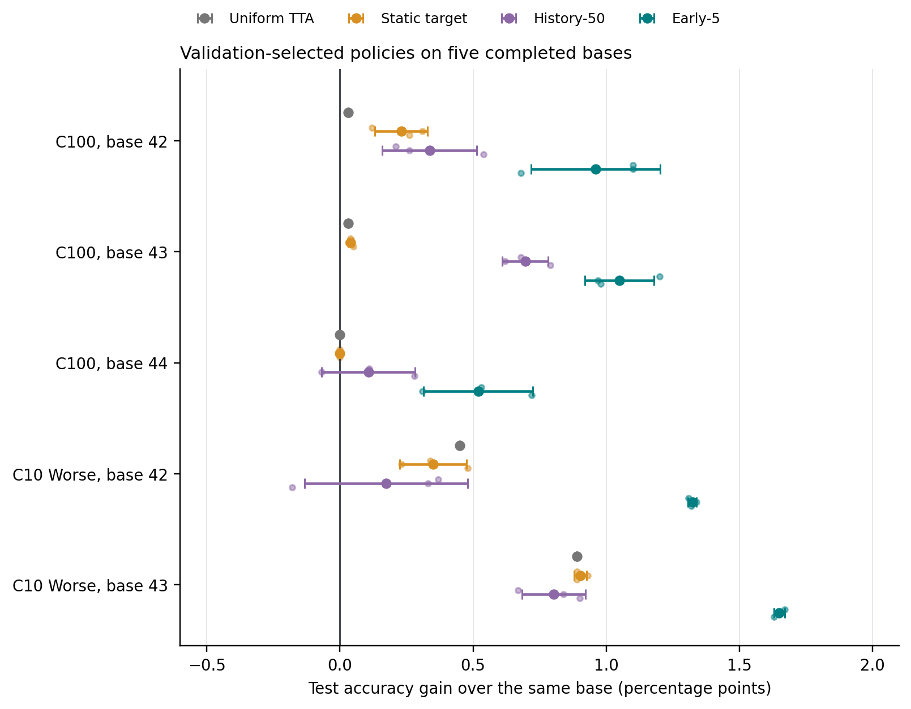

# Room for Doubt

Distilling training dynamics for inference-time uncertainty estimation.

The project studies whether a classifier's training dynamics can be distilled
into a reliability signal for new images. The current estimator predicts an
**early probability-margin summary** from an image and candidate class, then
uses that score to rank base-model errors and weight test-time augmentations.

## Current evidence

The current exploratory study uses ImageNet-initialized ResNet50 bases trained
for 50 epochs on official CIFAR-N noisy labels. Checkpoints are selected by
minimum noisy-validation cross entropy. A class-conditioned scalar head predicts
the mean margin over the first five epochs (**Early-5**) from frozen base features.

| Dataset / base initialization | Base accuracy | Uniform TTA | Early-5 | Gain over base |
|---|---:|---:|---:|---:|
| CIFAR-100N / 42 | 70.12% | 70.15% | 71.08% | +0.96 pp |
| CIFAR-100N / 43 | 69.23% | 69.26% | 70.28% | +1.05 pp |
| CIFAR-100N / 44 | 69.57% | 69.57% | 70.09% | +0.52 pp |
| CIFAR-10N Worse / 42 | 88.84% | 89.29% | 90.16% | +1.32 pp |
| CIFAR-10N Worse / 43 | 89.63% | 90.52% | 91.28% | +1.65 pp |

Early-5 values average three head initializations **within each base**. Those
heads are not three independent base-training runs. Each method selects its own
view count and temperature using noisy validation. Test results have been
inspected during development and remain exploratory; further replications are
pending. Uniform TTA selects ten views on four bases and one on CIFAR-100N seed44;
Early-5 selects five or ten depending on the base and head. Accuracy is downstream
FP32 evaluation throughout. Across independent bases, mean gains over base are
+0.84 pp (CIFAR-100N, n=3) and +1.49 pp (CIFAR-10N Worse, n=2). Between-base
sample SDs of these gains are 0.28 and 0.23 pp, not confidence intervals.



Large dots show head means; small dots show individual heads; error bars are
sample standard deviations across heads, not confidence intervals across bases.
The uniform-TTA point has no learned head.

Early-5 improves original-view base-error AUROC, but worsens ECE and NLL on
all three CIFAR-100N bases; CIFAR-10N ECE changes direction across bases.
One new CIFAR-100N head has a paired gain interval including zero against base. A two-base CIFAR-100N ensemble reaches **73.01%**, above the weighted
single-base results. No superiority over ensembles or lower inference latency is
claimed. Static and temporal target construction also differs in augmentation
and measurement conditions; the target comparison does not isolate a causal
benefit from time alone.

An augmentation-matched static control now covers all three CIFAR-100N bases
and CIFAR-10N Worse base43. CIFAR-100N augmented-static accuracies are
**70.32% / 69.27% / 69.57%** (bases42/43/44), versus Early-5
**71.08% / 70.28% / 70.09%**. The mean per-base advantage is **+0.76 pp**;
seven of nine conditional head-level accuracy intervals are positive, while two
on base44 include zero. On C10 base43, the control obtains **90.61%** versus
**91.28%**, with all three intervals positive. All twelve original-view AUROC
difference intervals are positive. These heads span four independent bases.
The C10 base42 augmentation control remains blocked by missing verified study
inputs. The control addresses augmentation acquisition, but does not isolate
time from online weights or the CE/GCE schedule. C100 base42 uses a recovered
native FP32 probability cache with recorded provenance and reproduced frozen
accuracies; bit-identical shared probabilities are not claimed.

A preliminary one-session Tesla T4 microbenchmark finds close equal-view timing:
including preprocessing, C100 five-view uniform/Early-5 medians are **20.25/20.36 ms**;
C10 ten-view medians are **40.93/41.01 ms**, batch size one. One-view base medians
are **7.59/7.52 ms**. Four fixed validation images, one session and no independent
timing intervals limit interpretation of small differences. No ensemble is timed.

[Editable manuscript, compact evidence and figure generation](paper/README.md).
All displayed figures and tables can be regenerated without training or weights.

## How the project evolved

The original ICOMP study explored full-trajectory regression / conditional flow
matching, a downstream LDA or random-forest detector, Top-2 correction and
uncertainty-weighted TTA. That implementation remains available in the research
package. Historical ResNet34 results and checkpoints are not interchangeable
with the current ResNet50 experiment.

The shared idea is **distilling learning dynamics for inference-time reliability**.
Early-5 is the current, simpler evidence-backed variant: it predicts one scalar,
reuses the selected base's features, and needs neither clean/noisy detector
supervision nor a Top-2 override. A weaker full-history mean does not demonstrate
that every full-trajectory representation is unhelpful. Previous trajectories,
CFM and correction remain research alternatives; their old numbers are not
combined with the new results as one matched evaluation.

## Runnable pipeline

See [Kaggle setup and launch](docs/kaggle.md) for one-cell packaging, required
Inputs, independent-base campaigns, checkpoint recovery and memory bounds.

- `python scripts/run.py train-kaggle-base`: train a resumable ResNet50 base and
  record 50-epoch probability margins with stable sample IDs.
- `python scripts/run.py post-kaggle source_run=/path/to/base`: fit new meta heads
  and compare base / shared-view TTA / static scores / trajectory predictors.
- `python scripts/run.py diagnose-kaggle source_run=/path/to/base post_run=/path/to/post`:
  inspect saved caches, scalar controls, reconstruction and numerical consistency.
- `python scripts/run.py study-base-features source_run=/path/to/base post_run=/path/to/post`:
  compare matched static, early and full-history-mean heads on ResNet18 and base
  features, with train-only PCA and noisy-validation policy selection.
- `python scripts/run.py run-kaggle-campaign`: run bounded independent-base jobs;
  dataset-specific profiles and their launchers are documented in the Kaggle guide.

Two follow-up commands have completed on C100 bases42/43/44 and C10 Worse base43:

- `python scripts/run.py contrast-feature-targets study_run=/path/to/full/study`:
  direct paired Early-5 versus Static/History-50 accuracy and AUROC comparisons,
  using the saved validation-selected policies and per-example predictions.
- `python scripts/run.py study-augmentation-control source_run=/path/to/base study_run=/path/to/full/study`:
  construct a static target under the actual training augmentation distribution,
  reuse existing features/PCA/heads, and fit only the new static heads.

A third follow-up, `python scripts/run.py benchmark-runtime`, prepares matched
inference-cost measurements for the base, uniform TTA and Early-5. It records
synchronized batch timings, separate model-only / preprocessing-inclusive scopes,
and CUDA allocated memory where available. The first T4 measurements are preserved in the manuscript evidence.

These follow-ups require full Outputs, not just compact summaries. For external shared caches,
pass `post_run`; see the [follow-up instructions](docs/kaggle.md#follow-up-direct-target-contrasts-and-an-augmentation-matched-static-control).

No base retraining is needed to regenerate the manuscript plots:

```bash
python paper/build_tables.py
python paper/build_figures.py
python paper/build_followups.py
```

## Local installation

Python 3.10+:

```bash
python -m pip install -e '.[dev]'
python scripts/run.py --help
python scripts/run.py train-kaggle-base --cfg job --resolve
```

Inspecting configuration does not download data or start training. A local GPU run:

```bash
python scripts/run.py train-kaggle-base output_dir=outputs data_dir=data
```

The default Kaggle configuration downloads CIFAR images, official noisy labels,
and ImageNet weights automatically. No private checkpoints are required.

## Research code

```text
configs/                 Hydra experiment configurations
src/room_for_doubt/
  data/                  Dataset loading, identities and splits
  models/                Base classifiers and trajectory predictors
  training/              Base and meta-model training
  dynamics/              Trajectory formats
  inference/             Frozen features, shared-view caches and flow sampling
  evaluation/            Metrics and inference-time policies
  analysis/              Matched comparisons and bounded studies
  reporting/             Per-run configuration, metrics and reports
  plotting/              Scientific plots
  legacy/                Historical exploratory commands
scripts/                 Launchers and repository size guard
tests/                  Lightweight offline checks
```

Historical commands may require locally stored data, trajectories and weights.
Their presence in the package does not make them compatible with the new base.
[Reproduction](docs/reproduction.md) and [layout](docs/repository_layout.md).

Generated reports, checkpoints, datasets, raw predictions and agent notes remain
local. Every new run still creates `config.yaml`, `metrics.json`,
`run_metadata.json`, `report.md`, tables and applicable checkpoints/artifacts.

## Protocol

Use noisy training labels for training and noisy validation for checkpoint and
policy selection. Use clean test labels for evaluation, never for fitting or
policy tuning. The existing test inspections during development are disclosed
in the manuscript as exploratory. Any clean
training-label detector supervision must be labeled **oracle**. Preserve stable
sample IDs, disjoint splits, explicit epoch indices, and record incomplete runs
rather than filling missing trajectories with zero.

Multiple independent base seeds and separate evaluation are needed for final
claims. Current exploratory results are not a universal effectiveness guarantee.
ARIS is an optional local aid, not a package dependency.

## Checks

```bash
python -m pytest -q -m 'not integration'
python scripts/check_file_sizes.py --history
```

No publication license has been selected by the project owner.
